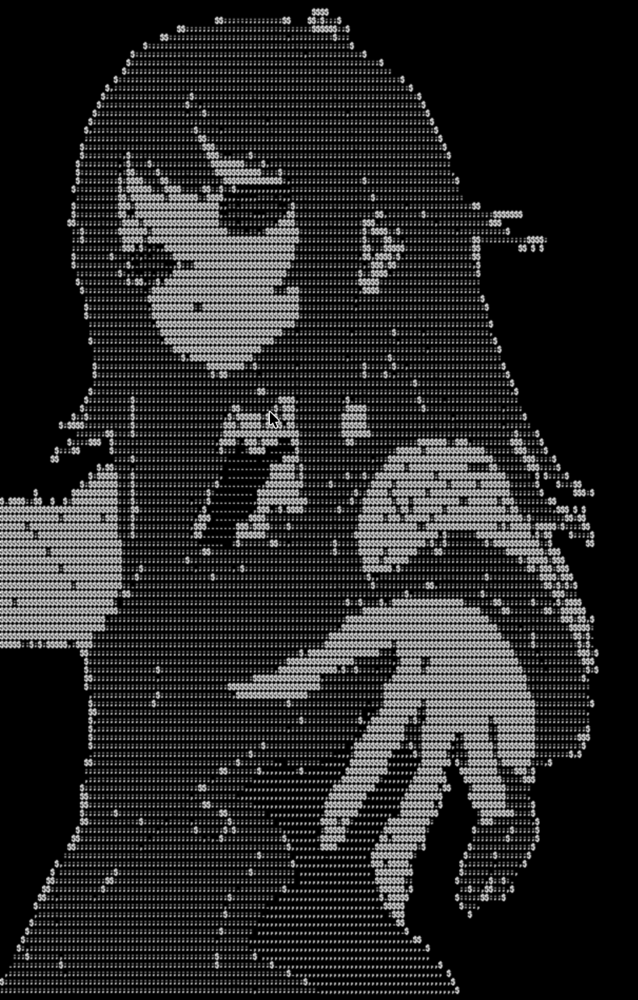
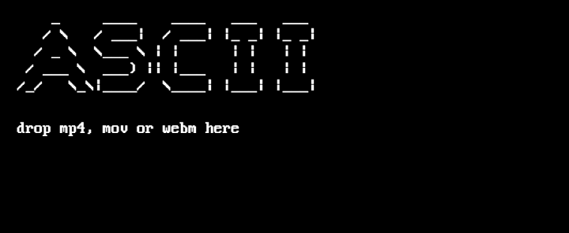

# RasterTerm


**RasterTerm** は、動画をASCII文字へリアルタイムに変換して再生するデスクトップアプリケーションです。レトロなターミナルをイメージした、黒い画面と白い文字だけの表示に特化しています。

Electronを使用したmacOS・Windows向けアプリです。動画の変換と再生は端末内で行われます。

## スクリーンショット

### ASCII再生



### 起動画面



## 主な機能

- **動画のASCII再生** — MP4 / MOV / WebMをドラッグ＆ドロップして読み込み、音声なしで繰り返し再生します。
- **Gallery** — 動画をアプリ内のローカルLibraryに登録し、OS標準のファイル選択ダイアログから追加・選択・削除できます。登録時には同一内容の重複を判定し、削除した動画はOSのゴミ箱へ移動します。
- **Display Mode** — `Fit` は表示領域に映像全体を収め、`Scroll` は映像比率に応じてスクロール表示します。
- **Font Size** — 8 / 10 / 12 / 14 / 16 / 18 / 20pxから選択できます（初期値16px）。
- **Loop Style** — `Transition` は動画の繰り返し時に黒侵食・黒画面・Revealの演出を行い、`Direct` は演出なしでループします。異なる動画への切り替えには、どちらの設定でも黒侵食・Revealを使用します。
- **設定の保存** — 表示モード、文字サイズ、ループ方式を保存し、次回起動時に復元します。

> 対応拡張子のファイルでも、内部の映像コーデックによっては再生できない場合があります。GIFや静止画の読み込みには対応していません。

## ダウンロード・インストール

配布版は **[GitHub Releases](https://github.com/etihw-fff/rasterterm/releases)** からダウンロードできます。専用のダウンロードサイトはありません。

| OS                             | ダウンロードするファイル           | インストール方法                                  |
| ------------------------------ | ---------------------------------- | ------------------------------------------------- |
| macOS（Apple Silicon / Intel） | `rasterterm-0.1.1-universal.dmg`   | DMGを開き、RasterTermをApplicationsフォルダへ移動 |
| Windows（Intel / AMD）         | `rasterterm-0.1.1-x64-setup.exe`   | インストーラーを起動し、画面の案内に従う          |
| Windows（ARM64）               | `rasterterm-0.1.1-arm64-setup.exe` | インストーラーを起動し、画面の案内に従う          |

**署名について：** 現在配布するビルドは、macOSではAppleによる公証なし、Windowsではコード署名なしです。このため、OSのセキュリティ警告が表示される可能性があります。ダウンロード元とファイルを確認したうえで、ご自身の環境のセキュリティ設定に従って判断してください。

## 使い方

1. RasterTermを起動し、動画ファイルを画面にドラッグ＆ドロップします。ドラッグ＆ドロップで読み込める動画は一度に1ファイルです。
2. OSのアプリケーションメニューにある **設定** から `Display Mode`、`Font Size`、`Loop Style` を変更できます。
3. **ギャラリー** メニューの「追加…」「選択…」「削除…」から、登録済み動画を管理できます。

Galleryへの追加では複数ファイルを選択できます。登録した動画はローカルに保存され、次回起動時も利用できます。

## 技術構成

| 領域               | 技術                                           |
| ------------------ | ---------------------------------------------- |
| デスクトップアプリ | Electron                                       |
| アプリケーション   | TypeScript（Main / Preload / Renderer）        |
| 表示・描画         | HTML、SCSS、Canvas 2D API                      |
| ビルド・パッケージ | electron-vite、electron-builder                |
| 単体テスト         | Vitest                                         |
| E2Eテスト          | WebdriverIO / Electron                         |
| CI                 | GitHub Actions（macOS / Windows、x64 / ARM64） |

動画のフレームを読み取り、明るさに応じたASCII文字に変換してCanvasへ描画します。UIの操作はElectronのOS標準メニューを使用しています。

## 開発環境での実行

Node.js 24.20.0以上（25未満）、npm 11.19.0以上（12未満）が必要です。リポジトリをクローンした後、次を実行します。

```bash
npm ci
npm run dev
```

テスト・ビルド用のコマンド：

```bash
npm run check:all   # フォーマット・Lint・型検査・単体テスト
npm run test:e2e    # 本番ビルドとElectron E2E
npm run package:mac # macOS Universal DMGを生成（macOS環境）
npm run package:win # Windowsインストーラーを生成（Windows環境）
```

ビルド成果物は`dist/`に出力されます。実際のパッケージ生成はGitHub Actionsからも実行できます。

## ライセンス・クレジット

ASCII表示用フォントには、VileRによる **WebPlus IBM VGA 8x16**（[The Ultimate Oldschool PC Font Pack](https://int10h.org/oldschool-pc-fonts/) / CC BY-SA 4.0）を使用しています。詳細は [THIRD_PARTY_NOTICES.md](THIRD_PARTY_NOTICES.md) を参照してください。

本リポジトリの独自ソースコードに対する利用・再配布ライセンスは、現時点では設定されていません。公開されていること自体は再利用の許諾を意味しません。
